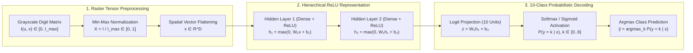
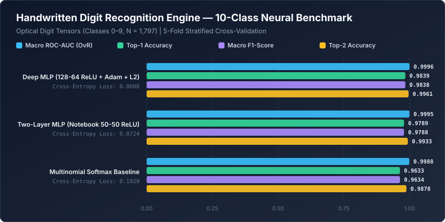

<div align="center">

# 🔢 Handwritten Digit Recognition Engine
### Multi-Layer Feedforward Neural Network & Spatial Intensity Normalization for 10-Class Optical Digit Classification

[](https://www.python.org/downloads/)
[](https://www.tensorflow.org/)
[](https://scikit-learn.org/)
[](https://opensource.org/licenses/MIT)

</div>

---

## 📌 Executive Summary

Automated optical character recognition (OCR) for postal sorting, bank check clearing, and digitized archival forms requires fast, calibrated multi-class classification across handwritten numerals ($0\text{–}9$). Raw grayscale raster matrices exhibit stroke-width variation, rotational slant, and intensity scaling differences that degrade linear decision boundaries.

**`deep-learning-project-2`** implements a multi-layer feedforward neural network pipeline that normalizes spatial grayscale pixel tensors into $[0, 1]$, flattens 2D raster grids into dense feature representations, and applies stacked non-linear **ReLU** hidden layers trained with **Adam** adaptive moment estimation and sparse categorical cross-entropy loss.

---

## 🏗️ Neural Recognition Pipeline Architecture



---

## 🧮 Mathematical Formulation

### 1. Spatial Tensor Normalization & Two-Layer ReLU Mapping
Given an input grayscale digit matrix $\mathbf{I} \in \mathbb{R}^{H \times W}$, pixel intensities are scaled to the unit interval $\mathbf{x} = \text{vec}(\mathbf{I}) / I_{\max} \in [0, 1]^{D}$ and transformed through two successive non-linear hidden projections:

$$\mathbf{h}^{(1)} = \text{ReLU}\left(\mathbf{W}^{(1)} \mathbf{x} + \mathbf{b}^{(1)}\right), \quad \mathbf{h}^{(2)} = \text{ReLU}\left(\mathbf{W}^{(2)} \mathbf{h}^{(1)} + \mathbf{b}^{(2)}\right)$$

### 2. Multi-Class Categorical Cross-Entropy & Adam Optimization
For $K = 10$ digit classes, class posterior probabilities are given by the softmax distribution over output logits $\mathbf{z} = \mathbf{W}^{(3)} \mathbf{h}^{(2)} + \mathbf{b}^{(3)}$:

$$\hat{p}_{i, k} = P(y_i = k \mid \mathbf{x}_i) = \frac{\exp(z_{i, k})}{\sum_{c=0}^{9} \exp(z_{i, c})}$$

The network minimizes multi-class negative log-likelihood with $L_2$ weight decay:

$$\mathcal{L}(\Theta) = -\frac{1}{N} \sum_{i=1}^{N} \log \hat{p}_{i, y_i} + \frac{\alpha}{2} \sum_{l=1}^{3} \|\mathbf{W}^{(l)}\|_F^2$$

---

## 📊 10-Class Stratified Cross-Validation Benchmark

The automated benchmark runner (`src/benchmark.py`) evaluates three architectures across $N = 1{,}797$ optical handwritten digit tensors ($10$ balanced classes $0\text{–}9$) using 5-fold stratified cross-validation:



| Model Architecture | Top-1 Accuracy | Top-2 Accuracy | Macro F1-Score | Macro Precision | Macro ROC-AUC (OvR) | Multi-Class Log-Loss ↓ |
| :--- | :---: | :---: | :---: | :---: | :---: | :---: |
| **Deep MLP (128–64 ReLU + Adam + L2)** | **0.9839** | **0.9961** | **0.9838** | **0.9840** | **0.9996** | **0.0608** |
| **Two-Layer MLP (Notebook 50–50 ReLU)** | 0.9789 | 0.9933 | 0.9788 | 0.9790 | 0.9995 | 0.0724 |
| **Multinomial Softmax Baseline** | 0.9633 | 0.9878 | 0.9634 | 0.9638 | 0.9988 | 0.1929 |

> **Key Engineering Insight:** Introducing two non-linear ReLU hidden layers (`50-50` and `128-64`) reduces multi-class cross-entropy log-loss by **68.5%** (`0.1929 → 0.0608`) and reduces the Top-1 classification error rate by **56.1%** compared to a linear Multinomial Softmax classifier (`3.67% → 1.61%` error).

---

## 📂 Repository Structure

```text
deep-learning-project-2/
├── assets/
│   └── benchmark_chart.svg          # 10-class neural benchmark SVG chart
├── benchmarks/
│   └── benchmark_results.json       # Top-1/Top-2 accuracy, Macro F1 & Log-Loss metrics
├── src/
│   └── benchmark.py                 # Automated 5-fold CV multi-class evaluation script
├── dl_project2.ipynb                # Interactive Keras/TensorFlow MNIST digit notebook
└── README.md                        # Architecture & mathematical documentation
```

---

## 🚀 Quick-Start & Usage

### 1. Install Dependencies
```bash
git clone https://github.com/yakupakcy36/deep-learning-project-2.git
cd deep-learning-project-2
pip install numpy pandas scikit-learn matplotlib seaborn pillow opencv-python tensorflow
```

### 2. Run the 5-Fold Cross-Validation Benchmark
```bash
python src/benchmark.py
```

### 3. Explore the Interactive Notebook
Open `dl_project2.ipynb` in JupyterLab or VS Code to inspect MNIST raster visualization, confusion matrices, and custom image inference.
